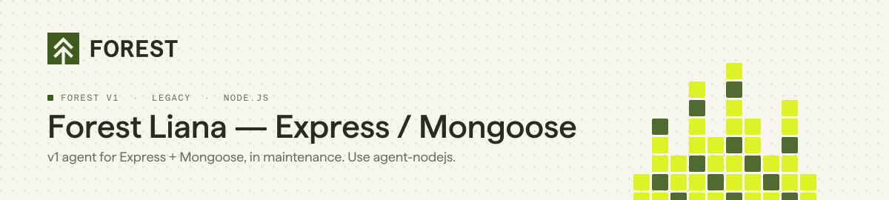
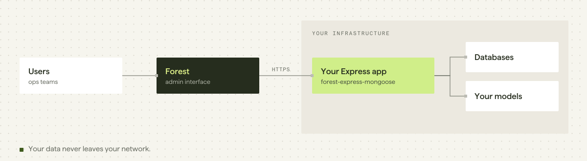

<p align="center">
  <picture>
    <source media="(prefers-color-scheme: dark)" srcset="./assets/header-forest-express-mongoose-dark.svg">
    
  </picture>
</p>

<p align="center">
  <a href="https://www.npmjs.com/package/forest-express-mongoose"></a>
  <a href="https://github.com/ForestAdmin/forest-express-mongoose/actions/workflows/build.yml"></a>
  <a href="./LICENSE"></a>
</p>

> [!IMPORTANT]
> **This is the Forest v1 agent for Express and Mongoose, in maintenance mode.** It receives fixes but no new features.
> **Starting a new project?** Use [agent-nodejs](https://github.com/ForestAdmin/agent-nodejs), the current Node.js agent.
> **Already on forest-express-mongoose?** Follow the [v1 to v2 migration guide](https://docs.forest.app/guides/migration/from-v1/overview).

## Quick start

```bash
npm install forest-express-mongoose
```

```js
const Liana = require('forest-express-mongoose');

app.use(await Liana.init({
  objectMapping: Mongoose,          // your project's Mongoose instance
  connections: { default: connection },
  envSecret: process.env.FOREST_ENV_SECRET,
  authSecret: process.env.FOREST_AUTH_SECRET,
}));
```

Exact signature and optional settings (`includedModels`, `excludedModels`, `configDir`, `schemaDir`): [`types/index.d.ts`](./types/index.d.ts).
Full guide: [docs.forest.app/legacy/javascript-agents/how-tos/setup/install](https://docs.forest.app/legacy/javascript-agents/how-tos/setup/install)

## Requirements

| | |
|---|---|
| Node.js | `>= 16` (CI runs on 24) |
| Database | MongoDB |
| ODM | Mongoose (your own instance, passed as `objectMapping`) |

This package builds on [`forest-express`](https://github.com/ForestAdmin/forest-express), the shared core of the v1 Express agents.

## How it works

<picture>
  <source media="(prefers-color-scheme: dark)" srcset="./assets/arch-forest-express-mongoose-dark.svg">
  
</picture>

The package runs **inside your Express application**. It introspects your Mongoose models and generates the admin API on your servers. The Forest interface calls this API: your data does not go through Forest.

## Documentation

| | |
|---|---|
| Install | https://docs.forest.app/legacy/javascript-agents/how-tos/setup/install |
| v1 reference guide | https://docs.forest.app/legacy/javascript-agents/reference-guide/models/overview |
| Upgrade notes | https://docs.forest.app/legacy/javascript-agents/how-tos/maintain/upgrade-notes-sql-mongodb/upgrade-to-v9 |
| Agents overview | https://docs.forest.app/legacy/agents-overview |
| Migrating to v2 | https://docs.forest.app/guides/migration/from-v1/overview |

## Contributing

Bug fixes are welcome; new features go to [agent-nodejs](https://github.com/ForestAdmin/agent-nodejs). See [CONTRIBUTING.md](./CONTRIBUTING.md) for setup, tests and commit conventions.

```bash
yarn install --frozen-lockfile && docker compose up -d && yarn test
```

## License

Apache 2.0. See [LICENSE](./LICENSE).
